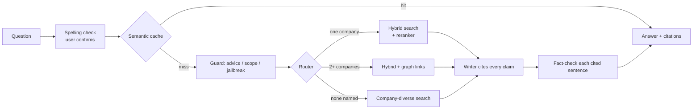

# kHop

Ask questions about the 2025 SEC filings (10-K and 10-Q) of 39 US semiconductor companies. kHop answers with numbered citations to the passages it used, fact-checks each cited sentence, and shows every step it took.

It is also a measurement project:
- Each component was compared with a simpler baseline on a dev question set I checked by hand.
- A separate held-out test set was scored once, at the end.
- Experiments that lost are written up in [docs/failures.md](docs/failures.md), and so are the components whose gain was not proven.

Answers are research output over public filings, **not investment advice**.

**Try the recorded demo:** https://atharva-87.github.io/kHop/ (real answers recorded from the app, replayed at their real speed; to ask your own questions, run it locally, see [Run it](#run-it)).

## What it does

- **Hybrid search** (BM25 keywords + bge-small embeddings, fused with reciprocal rank fusion) over section-aware chunks, each with a short header (company, form, period, section).
- **A rule router** sends each question one of three ways:
  - **one company:** search that company's filings, then rerank;
  - **two or more companies:** add knowledge-graph links between them;
  - **no company named:** spread the results across companies.
- **A local writer** (qwen3.5:4b through Ollama) must cite a passage for every claim.
- **A fact-checker** (MiniCheck-RoBERTa-Large, on CPU) marks any cited sentence its passage does not back.
- **Guardrails:**
  - refuses investment advice and off-topic requests;
  - treats retrieved text as untrusted (datamarking);
  - says so when the filings do not contain the answer.
- **The app:** FastAPI with a live, numbered step trace (Server-Sent Events) and a static Next.js page. It also has:
  - a semantic cache for reworded repeat questions;
  - a spelling layer that asks before it changes anything;
  - session history kept in the browser tab only.



## Results

All numbers below are generated from `results/*.json` by `python -m plexus.readme`, and a test fails if they drift. The search result files also record the config, the corpus checksum and the git commit. A commit marked `-dirty` had uncommitted changes in the working tree.

### Search: what each step adds

<!-- table:ladder -->
| Step | What it adds | All recall@10 [95% CI] | Local | Multi-hop | Multi-hop, both facts | Global: companies covered |
| --- | --- | --- | --- | --- | --- | --- |
| A0 | Naive RAG: fixed 300-word windows, dense search | 0.18 [0.11, 0.26] | 0.32 | 0.13 | 0.00 | 0.44 |
| A1–A2 | Section-aware chunks with headers, hybrid BM25 + dense (RRF) | 0.52 [0.41, 0.65] | 0.95 | 0.50 | 0.13 | 0.39 |
| A2-RR | No-graph baseline: alternate between the companies named | 0.54 [0.42, 0.68] | 0.95 | 0.59 | 0.35 | 0.39 |
| A3 | Cross-encoder reranker (bge-reranker-base) | 0.53 [0.42, 0.66] | 1.00 | 0.46 | 0.22 | 0.40 |
| A4 | Knowledge-graph hits fused in | 0.56 [0.43, 0.69] | 0.95 | 0.67 | 0.43 | 0.39 |
| A5 | Company-diverse ranking for sector-wide questions | 0.56 [0.43, 0.69] | 0.95 | 0.67 | 0.43 | 0.67 |
| A6 | Rule router picks the route per question (the app's base) | 0.58 [0.45, 0.72] | 1.00 | 0.67 | 0.43 | 0.67 |

Held-out test set, 91 questions, scored once at the end. One fix was made after seeing it (the ticker 'TI' was not linked to Texas Instruments); these numbers are from before that fix. Intervals: bootstrap over questions.
<!-- /table -->

"Multi-hop, both facts" counts a question only when the passages for both of its facts are in the top 10. Global questions span the whole sector, so they are scored by how many relevant companies the top 10 covers, not by single quotes.

### Answers and the fact-checker

<!-- table:answers -->
| Check | Result |
| --- | --- |
| Dev-set answers I judged correct (A6 writer; blind labels, after a blind re-label of borderline cases, see docs/failures.md) | 44/49 = 90% [78%, 96%] |
| Fact-checker flags real sentences I marked as not backed by their passage | 5/5 caught [57%, 100%] |
| ...the same, adding 10 test sentences paired with a wrong passage on purpose | 100% [80%, 100%] of 15 |
| Fact-checker passes sentences I marked as backed | 91% [79%, 96%] of 45 |
| Fact-checker vs me, agreement (kappa): real sentences / with the swapped ones | 0.67 / 0.84 |
| LLM judge accepted as a stand-in for me | no (below its pre-set bar) |
<!-- /table -->

### Guardrails

<!-- table:guardrails -->
| Guardrail | Result [95% CI] |
| --- | --- |
| Investment-advice requests refused (held-out) | 25/28 [73%, 96%] |
| Fair questions answered, not refused (held-out) | 28/32 [72%, 95%] |
| Off-topic requests refused (tuning set) | 20/20 [84%, 100%] |
| Questions the filings cannot answer: declined (eval set, not held out) | 18/20 [70%, 97%] |
| Hidden instructions planted in passages that changed the answer (the set that decided to keep datamarking) | 0/30 [0%, 11%] |
<!-- /table -->

### Serving on one laptop

<!-- table:serving -->
| Users at once | Answered | Told busy | First words p50 | Full answer p50 | Full answer, slowest |
| --- | --- | --- | --- | --- | --- |
| 1 | 2/2 | 0 | 4.2 s | 8.9 s | 8.9 s |
| 2 | 4/4 | 0 | 4.8 s | 14.5 s | 23.4 s |
| 4 | 8/8 | 0 | 19.1 s | 27.1 s | 34.5 s |
| 8 | 10/16 | 6 | 16.4 s | 22.1 s | 33.4 s |

| Measure | Result |
| --- | --- |
| Writer (local qwen3.5:4b) p50 | 3.5 s |
| Fact-check (CPU) p50 | 2.1 s |
| Search p50 | 0.55 s |
| Answer from the cache p50 | 59 ms |
| Reworded questions reused from the cache (held-out pairs) | 10/20 |
| Wrong answers reused from the cache | 0/20 |
| GPU memory, peak | 5,547 of 6,141 MiB |
| Cost per question | $0.00 |

One RTX 4050 laptop GPU (6 GB). Small samples: the slowest time is the maximum, not a true p95.
<!-- /table -->

### Spelling layer

<!-- table:reframe -->
| Check | Set | Without the layer | With it |
| --- | --- | --- | --- |
| Same search route as the correctly spelled question | fresh typos-anywhere set (338 sentences), not used for tuning | 82% | 98% |
| Same top-5 passages | same fresh set | 74/338 | 270/338 |
| Typo words changed to a wrong word | same fresh set | | 7/499 |
| Correct questions changed | all 225 golden questions, a keep bar used while building | | 0 |
| Company-name typos fixed | one-typo set, a keep bar used while building | | 113/113 |
<!-- /table -->

### Drift: the same questions on newer filings

<!-- table:drift -->
Not run yet. `make refresh` then `make drift` (writes results/drift.json).
<!-- /table -->

## What did not work

Full write-ups with numbers are in [docs/failures.md](docs/failures.md).

- **The graph's own gain over a strong no-graph baseline is not established on the held-out set.** It pointed the same way as on the dev set, but the interval crosses zero.
- **Multi-hop recall dropped from the dev set to the test set.** The dev set shaped the routing rules, and that gap is the overfitting the held-out set exists to catch.
- **Bridge questions** (the linking company is never named) are the weakest kind.
- **LLM judges were not accepted as a stand-in for my labels.** The quality figures above come from my blind labels.
- **Ten passages to the writer instead of five** made no significant difference, so the app uses five.
- **The spelling layer leaves ambiguous typos alone** ("fom" could be "from" or "for"). It also does not translate everyday wording into filing wording.

## Run it

Needs the conda env `torch` (Python 3.11), Ollama with `qwen3.5:4b`, and Node LTS for the page.

```bash
make install-ml      # pip install -c constraints.txt -e '.[ml,dev]'
make doctor          # what is missing and how to fix it
make ingest process  # download and parse the frozen snapshot (SEC_USER_AGENT in .env)
make index CONFIG=configs/app.yaml
make ui              # build the page into web/out
make serve           # http://127.0.0.1:8000
make stop            # free the GPU afterwards
```

Re-run one experiment: `make eval CONFIG=configs/a5_diverse.yaml`. Run the drift check: `make refresh drift`.

## Reproducibility

- **Dependencies** are locked in `uv.lock`. Local installs use `constraints.txt`, so the torch env never changes.
- **Every LLM call** goes through one client with a disk cache keyed by provider, model, prompt and parameters. CI runs cache-only (`PLEXUS_LLM_OFFLINE=1`), so reruns cost nothing.
- **The corpus snapshot is frozen:** `data/snapshots/*.manifest.jsonl` holds a sha256 per filing and a corpus checksum.
- **Fixed seeds and a fixed question set.** Both sets were drafted by an LLM and pre-reviewed by AI reviewer agents.
  - The dev set (for building) was checked by me question by question.
  - For the held-out test set (scored once), I approved the AI pre-review as a whole.
- **A retrieval regression gate runs on every PR,** and it has blocked a planted regression.

## LLM providers

| Provider | Use | Default |
| --- | --- | --- |
| Ollama (local) | Writer in the app, graph extraction | on |
| Gemini / Groq free tier | Question drafting, judges (public SEC text only) | on (key in `.env`) |
| `claude_sdk` | Personal local comparison runs only | **off**, never serves other users |

## Design decisions

Each major choice is recorded in [docs/adr/](docs/adr/) with the alternatives that were considered.

## AI-assisted development

kHop was built with Claude Code as a pair programmer. Commits it co-authored carry a `Co-Authored-By` trailer.

What I kept for myself:
- the golden-set labels;
- the answer-quality labels;
- the guardrail test labels;
- the decision records;
- review of every PR touching agents, metrics or the router.

Mistakes in AI-written code that tests or evals caught are logged in [docs/ai_review_log.md](docs/ai_review_log.md). Runtime models never use the developer's Claude login: the app runs on local models and free tiers only.
