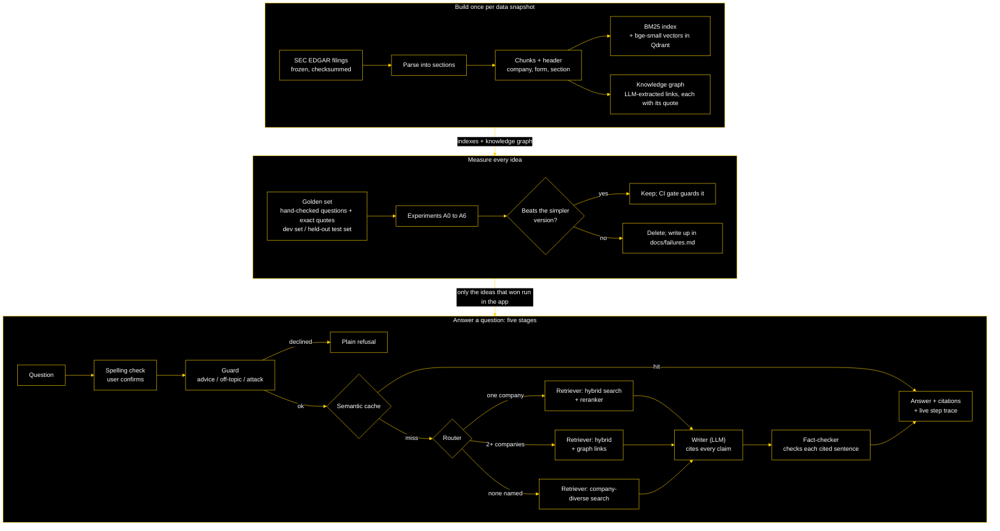

# kHop

**Ask a question about what chip companies told the SEC, and get a short answer where every sentence cites the exact filing passage it came from.**

kHop answers questions over the 2025 SEC filings (10-K annual and 10-Q quarterly reports) of 39 US semiconductor companies. It is a **Multi-Stage, Evidence-Grounded GraphRAG System**: five stages run in a fixed LangGraph workflow, each with one narrow job:
- a **guard** that declines unsafe requests;
- a **router** that picks how to search;
- a **retriever** that combines keyword search, embeddings, a reranker and a knowledge graph;
- a **writer** that drafts the cited answer (the only stage that calls an LLM; the others are rules or small models);
- a **fact-checker** that marks any sentence its source does not back.

The page streams every step live, so you can see how each answer was made. Agent-style loops (a planner, a rewrite loop) were tested and left out because they gave no measurable gain; making kHop agentic, then multi-agent, is on the [roadmap](#roadmap).

It is also a measurement project. Every component was compared with a simpler version on a question set checked by hand, and kept only if it helped. A held-out test set was scored once, at the end. The ideas that lost are written up in [docs/failures.md](docs/failures.md).

> **[Try the recorded demo →](https://atharva-87.github.io/kHop/)** Real answers recorded from the app, replayed at the speed they ran. To ask your own questions, run kHop on your computer ([setup below](#run-it-yourself)).

Answers are research output over public filings, **not investment advice**.

## How it works



| Part | What it does |
| --- | --- |
| **Data** | 156 filings (2025) from 39 chip companies, downloaded from SEC EDGAR, frozen with a SHA-256 per file |
| **Chunks** | Section-aware pieces, each with a header naming the company, form, period and section |
| **Retriever** | Keyword search (BM25) + meaning search (bge-small embeddings in Qdrant), merged by Reciprocal Rank Fusion; a cross-encoder reranker for one-company questions |
| **Knowledge graph** | Supplier, customer and competitor links extracted by a local LLM, each kept only with a quote that proves it (LadybugDB) |
| **Router** | A rule: one company named → that company's filings + reranker; two or more → graph links; none → spread results across companies |
| **Writer** | qwen3.5:4b running locally through Ollama; must cite a passage for every sentence, or say the filings don't contain the answer |
| **Fact-checker** | MiniCheck (a small NLI model, on CPU) marks any cited sentence its passage does not support |
| **Guardrails** | Declines investment advice and off-topic requests; marks retrieved text so instructions hidden in a filing are ignored |
| **App** | FastAPI streaming (Server-Sent Events) + a static Next.js page; a semantic cache for reworded repeats; a "Did you mean this?" spelling check |

## Results

Every number below is generated from `results/*.json` by `python -m plexus.readme`, and a test fails if the README drifts from those files. The search result files also record the config, the corpus checksum and the git commit. A commit marked `-dirty` had uncommitted changes in the working tree.

### Search: what each step adds

<!-- table:ladder -->
| Step | What it adds | Named-company questions, recall@10 [95% CI] | Local | Multi-hop | Multi-hop, both facts | Global: companies covered |
| --- | --- | --- | --- | --- | --- | --- |
| A0 | Naive RAG: fixed 300-word windows, dense search | 0.25 [0.16, 0.37] | 0.32 | 0.13 | 0.00 | 0.44 |
| A1–A2 | Section-aware chunks with headers, hybrid BM25 + dense (RRF) | 0.78 [0.66, 0.91] | 0.95 | 0.50 | 0.13 | 0.39 |
| A2-RR | No-graph baseline: alternate between the companies named | 0.81 [0.68, 0.94] | 0.95 | 0.59 | 0.35 | 0.39 |
| A3 | Cross-encoder reranker (bge-reranker-base) | 0.79 [0.68, 0.93] | 1.00 | 0.46 | 0.22 | 0.40 |
| A4 | Knowledge-graph hits fused in | 0.84 [0.76, 0.93] | 0.95 | 0.67 | 0.43 | 0.39 |
| A5 | Company-diverse ranking for sector-wide questions | 0.84 [0.76, 0.93] | 0.95 | 0.67 | 0.43 | 0.67 |
| A6 | Rule router picks the route per question (the app's base) | 0.88 [0.80, 0.96] | 1.00 | 0.67 | 0.43 | 0.67 |

Held-out test set, 91 questions (60 name companies; the rest are sector-wide and scored by company coverage), scored once at the end. One fix was made after seeing it (the ticker 'TI' was not linked to Texas Instruments); these numbers are from before that fix. Intervals: bootstrap over groups of related questions (shared linking company or theme).
<!-- /table -->

"Multi-hop, both facts" counts a question only when the passages for both of its facts are in the top 10. Global questions span the whole sector, so they are scored by how many relevant companies the top 10 covers, not by single quotes.

### Answers and the fact-checker

<!-- table:answers -->
| Check | Result |
| --- | --- |
| Dev-set answers I judged correct (A6 writer, blind labels) after I re-labelled borderline ones blind, see docs/failures.md | 44/49 = 90% [78%, 96%] |
| ...the same answers, my first labels | 38/49 = 78% |
| Fact-checker flags real sentences I marked as not backed by their passage | 5/5 caught [57%, 100%] |
| ...the same, adding 10 test sentences paired with a wrong passage on purpose | 100% [80%, 100%] of 15 |
| Fact-checker passes sentences I marked as backed | 91% [79%, 96%] of 45 |
| Fact-checker vs me, agreement (kappa): real sentences / with the swapped ones | 0.67 / 0.84 |
| LLM judge (one verdict per answer) vs me: Cohen's kappa / catches answers I marked not correct | 0.63 / 3 of 5 |
| LLM judge (pre-registered checklist) vs me: Cohen's kappa / catches answers I marked not correct | 0.49 / 3 of 5 |
| LLM judge accepted as a stand-in for me (bar: catch 70%, pass 85%) | no (below its pre-set bar) |
| RAGAS (gemini-3.5-flash-lite judge; complete) | answers scored per metric below |
| RAGAS faithfulness: claims backed by the retrieved passages | 0.95 (49 of 49) |
| RAGAS context recall: passages contain what the reference needs | 0.90 (49 of 49) |
| RAGAS answer relevancy: the answer addresses the question | 0.77 (49 of 49) |
<!-- /table -->

**How to read this table:**
- **Cohen's kappa** measures how far two graders agree beyond what chance would give: 1 is perfect agreement, 0 is chance level.
- **LLM judges:** both agreed with my labels only moderately, and missed answers I had marked not correct, so they failed the bar set in advance. Answer quality is therefore reported from my own blind labels.
- **RAGAS** (Retrieval-Augmented Generation Assessment, the standard RAG metric library) scored the same labelled answers with one judge model on Gemini's free tier. It runs in daily batches; `make ragas` resumes where the quota stopped it and reproduces offline from the LLM cache.
  - **Faithfulness and context recall are high.** This agrees with the fact-checker and with the search scores.
  - **Answer relevancy:** the answers stay on the question asked.
  - **Context precision is not shown.** RAGAS judges each passage on its own against the whole reference answer. On a two-company question each passage holds one company's half, so it is marked "not useful" even when search found all the evidence. The score then measures the question type rather than search quality. All six metrics are in `results/ragas_a6_router.json`.
  - **Factual correctness is not shown.** It penalises correct detail missing from the short reference answer, and its score separates my correct from not-correct answers no better than chance. My blind labels remain the quality measure.

### Guardrails

<!-- table:guardrails -->
| Guardrail | Result [95% CI] |
| --- | --- |
| Investment-advice requests refused (held-out) | 25/28 [73%, 96%] |
| Fair questions answered, not refused (held-out) | 28/32 [72%, 95%] |
| Off-topic requests refused (tuning set) | 20/20 [84%, 100%] |
| Questions the filings cannot answer: declined (eval set, not held out) | 18/20 [70%, 97%] |
| Hidden instructions planted in passages that changed the answer (the set that decided to keep datamarking) | 0/30 [0%, 11%] |
<!-- /table -->

### Serving on one laptop

<!-- table:serving -->
| Users at once | Answered | Told busy | First words p50 | Full answer p50 | Full answer, slowest |
| --- | --- | --- | --- | --- | --- |
| 1 | 2/2 | 0 | 4.2 s | 8.9 s | 8.9 s |
| 2 | 4/4 | 0 | 4.8 s | 14.5 s | 23.4 s |
| 4 | 8/8 | 0 | 19.1 s | 27.1 s | 34.5 s |
| 8 | 10/16 | 6 | 16.4 s | 22.1 s | 33.4 s |

| Measure | Result |
| --- | --- |
| Writer (local qwen3.5:4b) p50 | 3.5 s |
| Fact-check (CPU) p50 | 2.1 s |
| Search p50 | 0.55 s |
| Answer from the cache p50 | 59 ms |
| Reworded questions reused from the cache (held-out pairs) | 10/20 |
| Wrong answers reused from the cache (upper 95% bound) | 0/20 (15%) |
| GPU memory, peak | 5,547 of 6,141 MiB |
| Cost per question | $0.00 |

One RTX 4050 laptop GPU (6 GB). Small samples: the slowest time is the maximum, not a true p95.
<!-- /table -->

### Spelling layer

<!-- table:reframe -->
| Check | Set | Without the layer | With it |
| --- | --- | --- | --- |
| Same search route as the correctly spelled question | fresh typos-anywhere set (338 sentences), not used for tuning | 82% | 98% |
| Same top-5 passages | same fresh set | 74/338 | 270/338 |
| Typo words changed to a wrong word | same fresh set | | 7/499 |
| Correct questions changed | all 225 golden questions, a keep bar used while building | | 0 |
| Company-name typos fixed | one-typo set, a keep bar used while building | | 113/113 |
<!-- /table -->

### Drift: the same questions on newer filings

<!-- table:drift -->
| Snapshot | Filings | By form | Companies |
| --- | --- | --- | --- |
| semis-2025 | 156 | 39 10-K, 117 10-Q | 39 |
| semis-2026 | 121 | 33 10-K, 88 10-Q | 39 |

Of 225 golden questions, 74 have every evidence quote repeated word for word in the same company's newer filings; 68 partly; 83 not at all; 0 have no newer filing. Only carried-over questions can be scored on the new index, so the comparison below measures how search copes with a new corpus, not whether changed facts are found. Search settings: `a3h_rerank` (hybrid + headers + reranker; no router, company filter or graph, because a graph needs a long LLM extraction per snapshot). Sector-wide questions are left out of the comparison: they are scored by company coverage, not by quotes.

| Carried-over questions | Old index | New index | New minus old [95% CI] |
| --- | --- | --- | --- |
| recall@10 (68 questions) | 0.80 [0.72, 0.90] | 0.80 [0.72, 0.90] | +0.00 [+0.00, +0.00] |

Per question: 2 up, 2 down, the rest unchanged. Intervals resample whole groups of questions that share a linking company, as in the main scorer; when the ups and downs fall in the same groups and cancel, the interval has zero width.
<!-- /table -->

## What did not work

Full write-ups with numbers are in [docs/failures.md](docs/failures.md).

- **The graph's own gain over a strong no-graph baseline is not established on the held-out set.** It pointed the same way as on the dev set, but the interval crosses zero.
- **Multi-hop recall dropped from the dev set to the test set.** The dev set shaped the routing rules, and that gap is the overfitting the held-out set exists to catch.
- **Bridge questions** (the linking company is never named) are the weakest kind.
- **LLM judges were not accepted as a stand-in for my labels.** The quality figures above come from my blind labels.
- **Ten passages to the writer instead of five** made no significant difference, so the app uses five.
- **The spelling layer leaves ambiguous typos alone** ("fom" could be "from" or "for"). It also does not translate everyday wording into filing wording.

## Run it yourself

### What you need

| | Requirement |
| --- | --- |
| **OS** | Linux (built and tested on Ubuntu). macOS should work for everything except GPU speed. |
| **Python** | 3.11 (conda or venv) |
| **GPU** | An NVIDIA GPU with 6 GB or more is recommended (built on an RTX 4050 laptop). Without one, the writer and search run on CPU, slowly. |
| **Ollama** | [ollama.com](https://ollama.com), then `ollama pull qwen3.5:4b` (3.3 GB) |
| **Node.js** | 22 LTS, to build the web page |
| **Disk** | About 7 GB: models about 6 GB, data and indexes about 1 GB |
| **Word list** | `sudo apt install wamerican` (Debian/Ubuntu). The spelling check switches itself off without it. |
| **Cost** | $0. Everything runs locally; no API key is needed to run the app. |

### Settings (`.env`)
Copy `.env.example` to `.env`. It is git-ignored, so keys stay on your machine.

| Variable | Needed for | Example / default |
| --- | --- | --- |
| `SEC_USER_AGENT` | Only `make ingest` and `make refresh` (downloading filings from SEC). SEC asks for your name and email. | `"Jane Doe jane@example.com"` |
| `OLLAMA_API_BASE` | The writer | `http://localhost:11434` |
| `GEMINI_API_KEY` / `GROQ_API_KEY` | Only to regenerate the question set or the LLM judges (free tiers). Not needed to run the app or reproduce results. | empty |
| `PLEXUS_LLM_OFFLINE` | `1` = answer only from the LLM cache and never call a model (CI uses this) | `0` |
| `PLEXUS_LLM_CACHE` | Where the LLM cache lives | `data/cache/llm.sqlite` |
| `PLEXUS_ENABLE_CLAUDE_SDK` | Personal comparison runs only; leave off | `0` |

Advanced, optional (read by the app, sensible defaults): `PLEXUS_CONFIG` (app config, default `configs/app.yaml`), `PLEXUS_RATE_PER_MIN` (questions per minute per user, default 10), `PLEXUS_SEMANTIC_CACHE` and `PLEXUS_TRACE_LOG` (file locations), `PLEXUS_OLLAMA_KEEP_ALIVE` (how long the writer stays loaded), `PLEXUS_ANSWER_ERROR` (the message shown when the writer is down), `PLEXUS_DEV_CORS` (only for the live-reload page in development).

### Setup

```bash
git clone https://github.com/ATHARVA-87/kHop.git && cd kHop
conda create -n khop python=3.11 -y && conda activate khop    # or: python3.11 -m venv .venv
make install-ml PY=python      # Python packages (torch pinned by constraints.txt)
cp .env.example .env           # then edit if needed (see the table above)
make doctor PY=python          # checks everything and says how to fix what's missing

ollama pull qwen3.5:4b         # the writer model
make minicheck PY=python       # fact-checker model: download + safe conversion to safetensors
make fetch PY=python           # processed filings + graph extractions (checksum-verified)
make graph PY=python           # build the knowledge graph from the extractions (no LLM)
make index CONFIG=configs/app.yaml PY=python   # chunk + embed + index (GPU, a few minutes)
(cd web && npm ci) && make ui  # build the web page
make serve PY=python           # open http://127.0.0.1:8000
make stop PY=python            # afterwards: free the GPU
```

`make fetch` skips the two slow steps. If you prefer to build everything from the source:
- `make ingest process` downloads and parses the filings from SEC; this needs `SEC_USER_AGENT`.
- `make extract` re-runs the graph extraction with the local LLM, which took about 1.5 hours on the RTX 4050.

### Reproduce the numbers without calling an LLM
Every LLM call made while building kHop is published as a release: [llm-cache-2026-10-30](https://github.com/ATHARVA-87/kHop/releases/tag/llm-cache-2026-10-30).

Search scores need no LLM at all, only the small embedding and reranking models. Answer-level runs read the cache.
1. Do the setup above up to `make graph` (you can skip Ollama and the web page).
2. Build the index for the setup you want, e.g. `make index CONFIG=configs/a6_router.yaml PY=python`.
3. Restore the cache: `gunzip khop-llm-cache-2026-10-30.sqlite.gz`, move it to `data/cache/llm.sqlite`, and set `PLEXUS_LLM_OFFLINE=1`.
4. Score the dev set: `make eval CONFIG=configs/a6_router.yaml PY=python` writes `results/a6_router.json`.
5. Score the held-out test set (the README's tables): `python -m plexus.eval.run --config configs/a6_router.yaml --golden data/golden/golden_test.jsonl --results-dir results/test`.

Other useful commands:
- `make test`: the fast test suite (what CI runs).
- `make refresh drift`: the 2026 snapshot and the drift check.
- `make help`: lists everything.

## Project layout

| Folder | What is inside |
| --- | --- |
| `src/plexus/` | The Python package (the project's earlier name): `ingest/`, `index/`, `retrieve/`, `extract/` (graph), `agents/` (LangGraph flow, fact-checker), `guardrails/`, `serve/` (FastAPI app), `eval/` (metrics and experiments), `llm/` (cached LLM client) |
| `web/` | The Next.js page |
| `configs/` | One YAML file per experiment (A0–A6, A8, A9; A7 was not built, see ADR 0007) and for the app |
| `data/golden/` | The hand-checked question sets and labels |
| `data/snapshots/` | Frozen corpus manifests with checksums |
| `results/` | One JSON file per experiment; README numbers come from here |
| `docs/` | Decision records (`adr/`), failures, AI review log, security notes, demo script |

## Terms used (full forms)

| Short form | Full form |
| --- | --- |
| RAG / GraphRAG | Retrieval-Augmented Generation / RAG that also follows a knowledge graph |
| LLM | Large Language Model |
| Stage | One step with one narrow job in the workflow (here: guard, router, retriever, writer, fact-checker) |
| Agentic / multi-agent | An LLM that decides its own next action (e.g. whether to search again) / several such agents working together. kHop is neither yet; see the roadmap |
| LangGraph | A library that runs the stages as a fixed workflow over shared state |
| ADR | Architecture Decision Record (one page per design choice, in `docs/adr/`) |
| SEC / EDGAR | U.S. Securities and Exchange Commission / Electronic Data Gathering, Analysis, and Retrieval |
| 10-K / 10-Q / MD&A | annual report / quarterly report / Management's Discussion and Analysis |
| SHA-256 | Secure Hash Algorithm (256-bit): a file fingerprint |
| BM25 | Best Matching 25 (Okapi BM25 keyword ranking) |
| RRF | Reciprocal Rank Fusion |
| BGE / BAAI | BAAI General Embedding / Beijing Academy of Artificial Intelligence |
| Qdrant | The vector database that stores the embeddings |
| Reranker / cross-encoder | A model that reads question and passage together to reorder results |
| KG / LadybugDB | Knowledge Graph / the embedded graph database that stores it |
| Ollama / qwen3.5:4b | Local LLM runner / the 4-billion-parameter writer model |
| NLI / MiniCheck | Natural Language Inference / the small model that does it for the fact-checker |
| RoBERTa | Robustly optimized BERT approach (BERT = Bidirectional Encoder Representations from Transformers) |
| Datamarking | Joining the words of retrieved text with `^` so the writer treats it as data, not instructions |
| Semantic cache / TTL | Reusing answers to reworded questions / Time To Live (cache expiry) |
| OSA | Optimal String Alignment (edit distance used by the spelling check) |
| SSE / API / CSP | Server-Sent Events / Application Programming Interface / Content Security Policy |
| CI | Continuous Integration (GitHub Actions); in result tables, CI also means Confidence Interval |
| Cohen's kappa | Agreement between two graders beyond chance (1 = perfect, 0 = chance) |
| RAGAS | Retrieval-Augmented Generation Assessment (a RAG metric library; run on the 49 answers I labelled) |
| recall@10 / nDCG / MRR | share of needed evidence in the top 10 / normalized Discounted Cumulative Gain / Mean Reciprocal Rank |
| p50 / p95 | typical (median) / 95th-percentile time |
| A0–A9 | The ablation ladder: each step adds one idea to the step before (A0–A6 search, A8 cache, A9 guardrails; A7 not built) |
| dev / test | development set (used for decisions) / held-out test set (scored once) |

## Roadmap

kHop is deliberately a fixed workflow today: every extra step had to beat the simpler version, and agent loops did not. The planned next steps follow the same rule. Each is built behind a switch, its pass mark is written before it runs, and it is kept only if it helps on the dev set.

1. **Self-correcting loop.** When the fact-checker finds a cited sentence its passage does not back, search once more (using that sentence) and rewrite. Keep the new answer only if fewer sentences are unbacked.
2. **Agentic: the writer chooses to search.** Give the writer LLM a `search_filings` tool. It decides whether, and what, to search again (at most two calls) before answering. This needs tool-calling support in the LLM client, and a first check that the 4B local model calls tools reliably.
3. **Multi-agent.** Split the work between LLM agents that hand off to each other in LangGraph:
   - a **planner** that breaks two-company questions into sub-questions;
   - a **researcher** per company that searches with tools;
   - a **writer**;
   - a **verifier** that can send the work back for another round.

   Each agent is added only if it beats the version before it.

## Design decisions

Each major choice is recorded as an Architecture Decision Record (ADR) in [docs/adr/](docs/adr/), with the alternatives that were considered. The index is in [docs/adr/README.md](docs/adr/README.md).

## AI-assisted development

kHop was built with Claude Code as a pair programmer. Commits it co-authored carry a `Co-Authored-By` trailer.

What I kept for myself:
- the golden-set labels;
- the answer-quality labels;
- the guardrail test labels;
- the decision records;
- review of every PR touching agents, metrics or the router.

Mistakes in AI-written code that tests or evals caught are logged in [docs/ai_review_log.md](docs/ai_review_log.md). Runtime models never use the developer's Claude login: the app runs on local models and free tiers only.

## License

Code: MIT ([LICENSE](LICENSE)). The filings are public SEC documents. The models keep their own licences: Qwen 3.5 via Ollama, BGE (MIT), MiniCheck (MIT).
